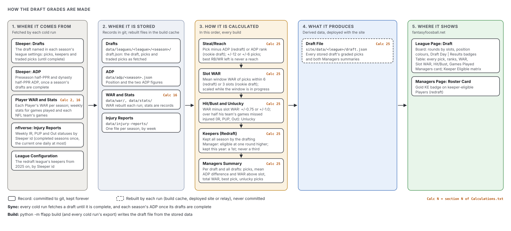

# How the Draft Grades Work

The League page's Draft tab shows every stored draft as a board and as a table, and grades each pick
two ways. **Steal/Reach** is the draft-day grade: was the Player taken well after or well before where
the wider market (ADP) took him? **Hit/Bust** is the retrospective grade: did he produce more or less
WAR than that draft spot usually does in this league? A Player who missed most of his team's games is
**Unlucky** instead, when he missed most of his team's games injured. In the redraft league the tab also
shows the league's keepers and, under the latest draft, every Player keeper eligible for next season with
his price. Every grade is computed at build time into one file per league; the page only draws
it. This document follows the data from where it comes from to where it shows. The formulas are in
`Calculations.txt`. "Calc N" in the diagram and below means section N there.

- **Code:**
  - `src/ffapp/sync.py`: stores each season's draft and ADP.
  - `src/ffapp/sleeper.py`: the draft and season-projection requests.
  - `src/ffapp/store.py`: the draft and ADP files.
  - `src/ffapp/draft.py`: the grades, summaries, keepers and keeper eligibility, and the export.
  - `src/ffapp/injury_reports.py`: nflverse's weekly IR, PUP and Out statuses.
  - `src/ffapp/managers.py` and `site/managers.js`: the "KE" badge on the Roster card.
  - `site/draft.js`: the tab.
  - `site/league.js`: the League sub-tab's tabs and URL.
- **Runs:**
  - Every cold run's sync fetches a draft until it is complete, then keeps it.
  - Each cold run also fetches a season's ADP once that season's drafts are complete in every league.
  - The cold run's `injury-reports` step fetches each completed season's nflverse files once and the
    current season's at most once every 20 hours.
  - `python -m ffapp build`, and the export at the end of every cold run, write `site/data/<league>/draft.json`.
  - See `docs/refresh-modes.md` for when cold runs happen.
- **Tests:**
  - `tests/test_sync.py`: drafts and ADP.
  - `tests/test_draft.py`: the grades, keepers, keeper eligibility and export.
  - `tests/test_injury_reports.py`: the nflverse statuses and their fetch schedule.
  - `tests/test_colour_contrast.py`: badge and WAR colours.
  - `tests/layout/test_draft_page.py`: the tab in the browser.

## Diagram

Read it left to right. A solid box is a record, committed to git and kept forever. A dashed box is
rebuilt and never committed. The arrows in column 3 are the order of the calculations.

Redraw it after changing a source, a stored path, a calculation or what the Draft tab shows with
`python -X utf8 tools/draft_diagram.py`. Its wording must match this document.

## 1. Where the Data Comes From

| Source | What it gives the Draft tab | Fetched |
|---|---|---|
| Sleeper: Drafts | The draft named in each season's league settings: its settings, every pick (with keepers) and every traded pick. The dynasty league's 2022 startup draft, which only moved rosters over from Yahoo, is not the named draft and is never fetched. | Every cold run until the draft is complete, then never again |
| Sleeper: ADP | Each season's preseason half-PPR ADP (redraft) and dynasty half-PPR ADP (rookie drafts), from Sleeper's season projections | Once per season, when that season's drafts are complete |
| Player WAR and Stats (Calc 2, 16) | Each Player's WAR per season; weekly stats lines for games played and for which NFL teams played each week | WAR rebuilt each run; stats every cold run |
| nflverse: Weekly Rosters and Injury Reports | Each fantasy Player's IR (R01, R48) and PUP (R04) weeks by Sleeper id, and the weeks the injury report listed him Out | Each completed season once; the current season at most once every 20 hours |
| League Configuration | The redraft league's keepers from 2025 on, by Sleeper id (the league's rules are tracked outside Sleeper) | Read at each build |

## 2. Where It Is Stored

| Data | Path | Tier |
|---|---|---|
| Drafts | `data/leagues/<league>/<season>/draft.json` | Record |
| ADP | `data/adp/<season>.json` | Record |
| Player WAR (Calc 16) | `data/war/<league>/<season>.json` | Rebuilt |
| Weekly stats (Calc 2) | `data/stats/<season>/week_NN.json` | Record |
| Injury reports | `data/injury-reports/<season>.json` | Record |
| Keepers | `config/leagues.yaml` (`keepers`) | In git |

## 3. How It Is Calculated

1. **Steal/Reach (Calc 25).**
   - **Redraft:** the ADP difference is the pick number minus the Player's ADP. A steal is at least
     +12, a full round; a reach is −12 or less.
   - **Rookie drafts:** the difference is the pick number minus the Player's ADP rank among that
     draft's Players. A steal or reach is half a round, ±6.
   - **Exception:** an RB or WR who was one of the two lowest ADPs left at his position is never a
     reach.
   - Keepers and Players without an ADP get no grade.
2. **Slot WAR (Calc 25).**
   - A pick's window WAR is the Player's WAR on every roster over the draft season (redraft), or over
     the draft season and the next (rookie draft).
   - Slot WAR is the mean window WAR of the picks within 6 slots (redraft) or 3 slots (rookie draft),
     across the league's drafts whose window is complete. Keepers are left out.
   - While a pick's window is still being played, slot WAR is scaled by the share of its weeks played.
3. **Hit/Bust and Unlucky (Calc 25).**
   - A hit beats slot WAR by at least 0.75 WAR (redraft) or 1.0 WAR (rookie draft). A bust falls as
     far short.
   - A Player who missed more than half of his NFL team's games in the window while listed IR, PUP
     or Out is Unlucky, in place of Bust; a hit stays a hit. His team each week comes from his own stats line, else his nearest week's line.
4. **Ranks and the Managers summary (Calc 25).**
   - **Ranks:** overall and position ranks by ADP and by window WAR.
   - **Summary:** for each draft and across all of a league's drafts, each Manager gets their picks,
     mean ADP difference, mean WAR above slot WAR, total WAR, best pick and unlucky picks. Each pick
     counts for the Manager whose roster made it.

5. **Keepers and keeper eligibility (Calc 25, redraft).**
   - **Keepers:** the configured keepers from 2025 on, and Sleeper's flags for 2022 to 2024, are marked
     Keeper and not graded.
   - **Eligible:** for the latest draft, a Player his Manager drafted and held through the championship
     week, with no drop or trade away, is keeper eligible for next season.
   - **Price:** one round higher than he was drafted, so a first-round pick can't be kept. A Player
     kept this season costs a 1st, and one kept two seasons running is not eligible.
   - **In season:** the list runs through the latest week and is marked not final.

### How Often Each Grade Appears

Counts from the stored drafts at the 2026-11-27 build. Rookie drafts from 2025 on and redraft 2026 are
still in their grading windows, so their Hit/Bust and Unlucky counts will move.

| Draft | Picks | Steals | Reaches | Hits | Busts | Unlucky |
|---|---|---|---|---|---|---|
| Dynasty 2022 | 36 | 4 | 5 | 4 | 7 | 1 |
| Dynasty 2023 | 36 | 7 | 4 | 6 | 6 | 0 |
| Dynasty 2024 | 36 | 4 | 2 | 6 | 4 | 4 |
| Dynasty 2025 | 36 | 2 | 3 | 5 | 6 | 0 |
| Dynasty 2026 | 36 | 4 | 4 | 0 | 1 | 4 |
| Redraft 2021 | 168 | 24 | 26 | 25 | 30 | 12 |
| Redraft 2022 | 168 | 24 | 29 | 21 | 8 | 8 |
| Redraft 2023 | 168 | 20 | 35 | 11 | 28 | 6 |
| Redraft 2024 | 168 | 21 | 45 | 21 | 17 | 7 |
| Redraft 2025 | 168 | 17 | 49 | 21 | 6 | 14 |
| Redraft 2026 | 168 | 14 | 24 | 19 | 8 | 11 |

## 4. What It Produces

| Output | Path | Tier |
|---|---|---|
| The draft file (Calc 25): the rules (thresholds), Managers, and for every stored draft its slots and their Managers, each graded pick and the draft's Managers summary, plus the summary across all drafts; the latest redraft draft also carries the keeper-eligible list | `site/data/<league>/draft.json` | Rebuilt (derived data, deployed with the site) |
| Keeper-eligible flags on the redraft Roster card's rows | `site/data/<league>/managers.json` | Rebuilt |

## 5. Where It Shows

| Page | What it shows | Reads |
|---|---|---|
| League: Draft, Board | Rounds by draft slots under the slot Managers. Cells are tinted by position, a traded pick names the Manager who made it, and keepers are marked. A Draft Day / Results switch shows each pick's Steal/Reach or Hit/Bust/Unlucky badge | `site/data/<league>/draft.json` |
| League: Draft, Table | Every pick with these columns: Pick ("2.01 (13)"), Manager ("via" for traded picks), Player (with its Steal/Reach badge), ADP, ADP Rank and WAR Rank with position-rank badges, WAR, Slot WAR, Hit/Bust and Games Played | `site/data/<league>/draft.json` |
| League: Draft, Managers card | Each Manager's picks, mean Steal/Reach, mean Hit/Bust, total WAR, best pick and unlucky picks, for this draft or all drafts | `site/data/<league>/draft.json` |
| League: Draft, Keeper Eligible (redraft, latest draft) | Managers by price round, each eligible Player as a position chip, second-year keepers marked; one list per Manager on phones | `site/data/<league>/draft.json` |
| Managers: Roster card (redraft) | A gold "KE" badge after each keeper-eligible Player's name | `site/data/<league>/managers.json` |

Both views have a Season picker. On phones the board scrolls sideways with the round column pinned,
and the table becomes one list row per pick.

## Keeping This Document Current

Change this document, the diagram's generator and `Calculations.txt` section 25 together whenever a
source, a stored path, a draft calculation or what the Draft tab shows changes.
