# Games Page States

Every game card on the Games page is in exactly one of 11 states. The exporter works the state out once,
from the managers' real starters and bench and each player's NFL game as the site saw it at the last
refresh, and stores it on the card as `state`. The page then draws the card from one table keyed by that
state, so no part of the page guesses what is going on from which numbers happen to exist.

- **States:** `src/ffapp/card_states.py` (`card_state()`), used by `src/ffapp/games_export.py`.
- **Looks:** the `CARD_LOOK` table in `site/games.js`.
- **Calculations:** `Calculations.txt`, section 22 (Game card states).
- **Tests:** `tests/test_card_states.py` (every state and transition), `tests/layout/test_game_states.py`
  (every state's look), on the fixture week in `tests/layout/game_states.py`.

## Diagram

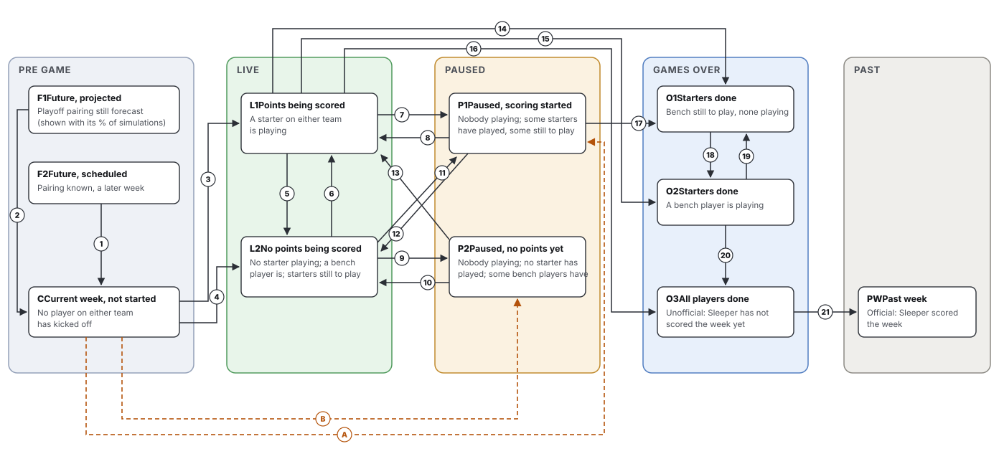

Solid arrows are real transitions, numbered as in the table below. Dashed orange arrows only happen because
the site sees the world at each refresh rather than continuously. Any state can also jump forward to a
later one when several changes happen between two refreshes.

## States

A state describes both fantasy teams together, using the managers' real starters and bench, never the Model
lineup.

| Doc | Code | Group | True when | Looks like |
|---|---|---|---|---|
| F1 | `projected` | Pre game | A later playoff week whose pairing is still a forecast | Forecast, key players, round label with how often the pairing happened |
| F2 | `scheduled` | Pre game | A later regular-season week | Forecast, key players, kickoff times |
| C | `not_started` | Pre game | The current week; nobody on either roster has kicked off | As F2: no Model / Actual toggle |
| L1 | `scoring` | Live | A starter is in a game in progress | LIVE badge, points so far, full lineups |
| L2 | `bench_only` | Live | No starter playing, a bench player is, starters still to play | Bench playing chip, no badge, full lineups |
| P1 | `paused` | Paused | Nobody playing; some starters played, some still to play | Points so far, full lineups |
| P2 | `paused_no_points` | Paused | Nobody playing; no starter has played, a bench player has | Forecast, key players, toggle |
| O1 | `starters_done` | Games over | Every starter finished; bench still to play, nobody playing | Unofficial and Bench to play chips, winner check, key players by impact |
| O2 | `starters_done_bench_playing` | Games over | Every starter finished; a bench player playing | Unofficial and Bench playing chips, winner check, key players by impact |
| O3 | `all_done` | Games over | Every player finished; Sleeper has not scored the week | Unofficial chip, winner check, key players by impact |
| PW | `final` | Past | Sleeper has scored the week | Winner check, key players by impact |

Key players by impact (O1 to PW, Actual view): the four starters with the largest win probability added in
either direction, largest first; ties on the whole percentage shown go QB, RB, WR, TE, DEF, K. The Model view
of these states shows the full lineup, because win probability added exists only for the managers' real
starters.

## Real Transitions

| # | From → to | Trigger |
|---|---|---|
| 1 | F2 → C | Sleeper scores the week before, so this week becomes current |
| 2 | F1 → C | The previous round is scored: the pairing is settled as the week becomes current |
| 3 | C → L1 | A starter kicks off |
| 4 | C → L2 | Only a bench player kicks off |
| 5 | L1 → L2 | The playing starters' games end while a bench player plays on; starters still to play |
| 6 | L2 → L1 | A starter kicks off |
| 7 | L1 → P1 | Every game in progress ends; starters still to play |
| 8 | P1 → L1 | A starter kicks off |
| 9 | L2 → P2 | The bench game ends; no starter has played yet |
| 10 | P2 → L2 | A bench player kicks off |
| 11 | L2 → P1 | The bench game ends; some starters had already played |
| 12 | P1 → L2 | Only a bench player kicks off |
| 13 | P2 → L1 | A starter kicks off |
| 14 | L1 → O1 | The last starter's game ends; bench still to play, none playing |
| 15 | L1 → O2 | The last starter's game ends while a bench player is playing |
| 16 | L1 → O3 | The last starter and the last bench player finish together (often Monday night) |
| 17 | P1 → O1 | The remaining starters' games are cancelled (finished with 0) |
| 18 | O1 → O2 | A bench player kicks off |
| 19 | O2 → O1 | The bench game ends; more bench still to play |
| 20 | O2 → O3 | The last bench player's game ends |
| 21 | O3 → PW | Sleeper scores the week |

## Snapshot-Only Transitions

| # | From → to | Why it can happen |
|---|---|---|
| A | C → P1 | A starter's whole game is played between two refreshes (Thursday night: the run after the game is the first to see it) |
| B | C → P2 | The same, for a bench player's game |
| any | any → later | Several real transitions happen between refreshes, so the page skips the states in between |

## Rules

- **Real lineups decide.** States use the managers' actual starters and bench, so switching between the Model
  and Actual views never changes a card's state.
- **No game means finished.** A player on bye, or an empty starter slot, can never score, so he counts as
  finished from the start of the week. A player ruled out counts as finished only when his team's game is over.
- **Postponed and cancelled games.** A postponed game keeps its players unfinished until it is played; a
  cancelled one finishes them with 0 points (ESPN reports it as over).
- **A week is past only when Sleeper scores it.** Until then a finished game is unofficial (O1 to O3), though it
  already shows the winner check for the team ahead.
- **Snapshots, not a feed.** The page shows the state of its latest refresh; the dashed transitions exist only
  because of that.

## Gallery

Each image is the state's card from the fixture week (a real finished week edited per state). Redraw them
after any change to how cards look:

```
python -X utf8 tools/games_states_gallery.py
```

### F1 · Future, Projected
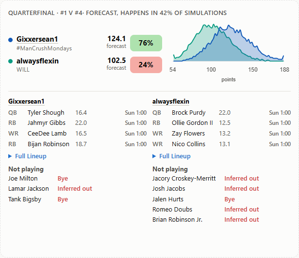

### F2 · Future, Scheduled
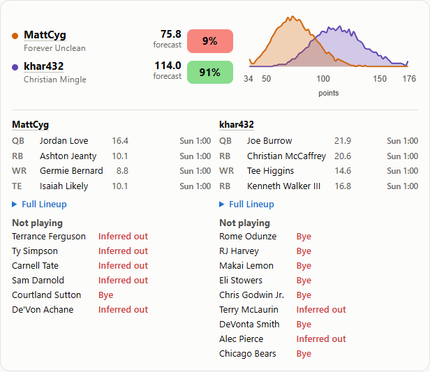

### C · Current Week, Not Started
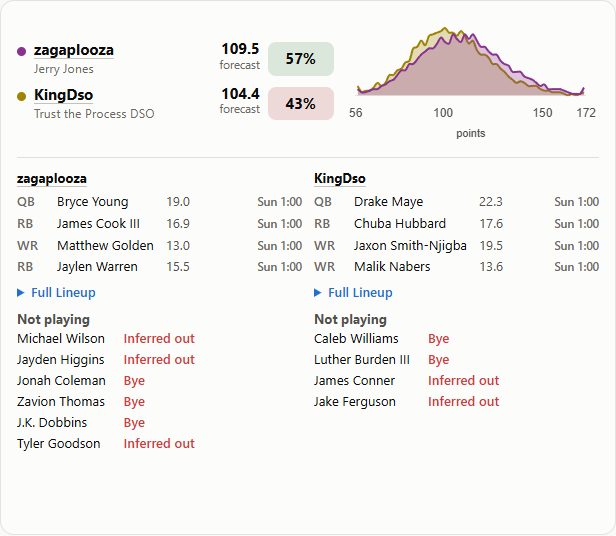

### L1 · Points Being Scored
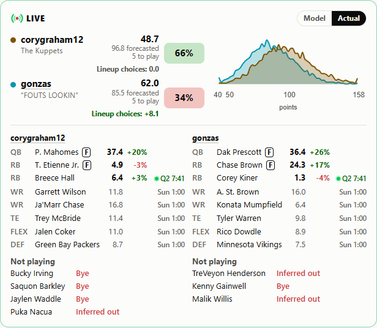

### L2 · No Points Being Scored
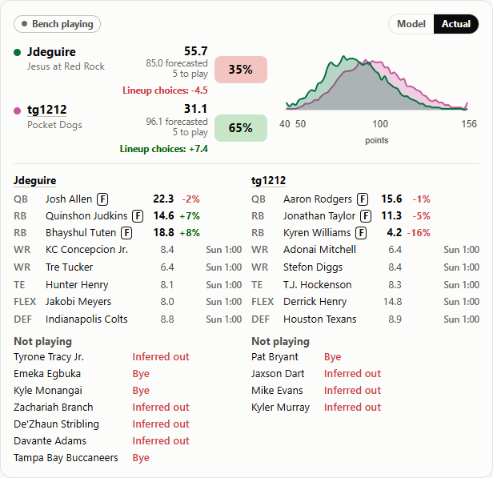

### P1 · Paused, Scoring Started
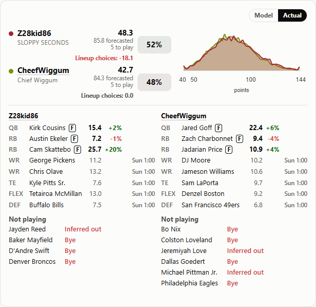

### P2 · Paused, No Points Yet
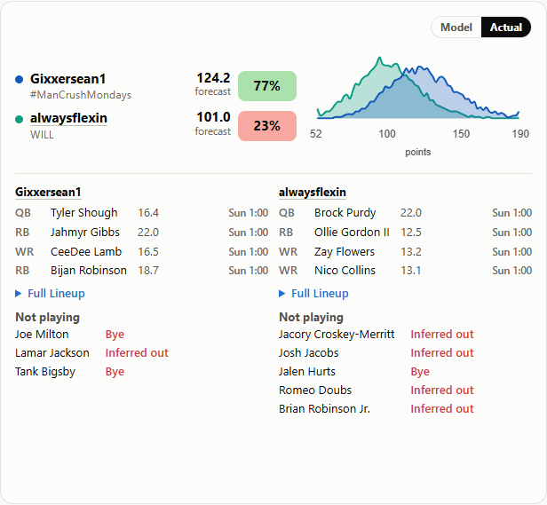

### O1 · Starters Done, Bench to Play
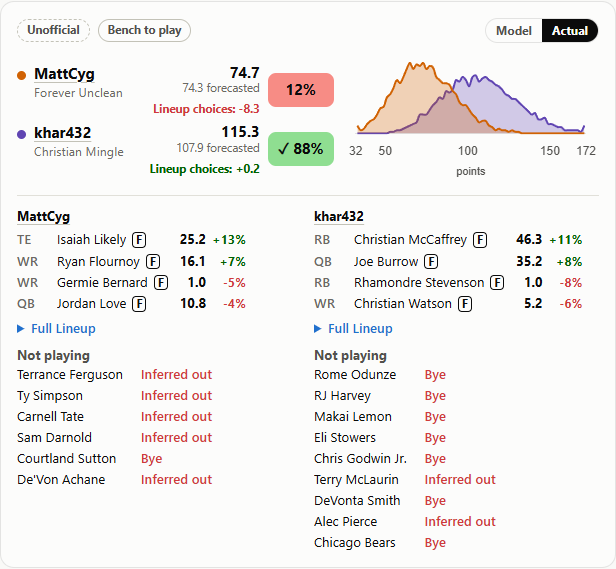

### O2 · Starters Done, Bench Playing
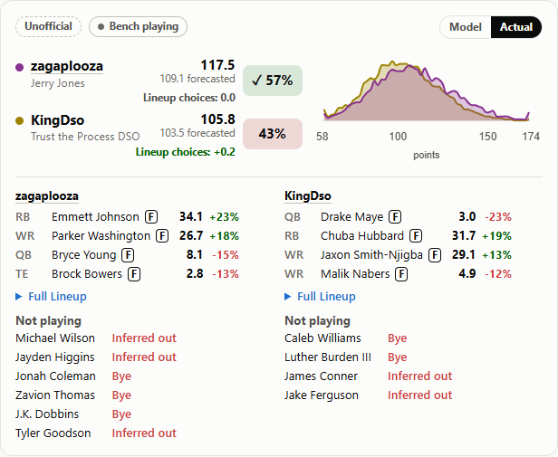

### O3 · All Players Done, Unofficial
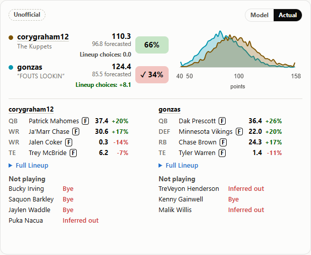

### PW · Past Week
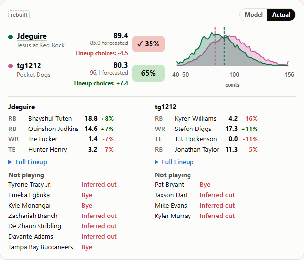

Past week, Model view (full lineup):

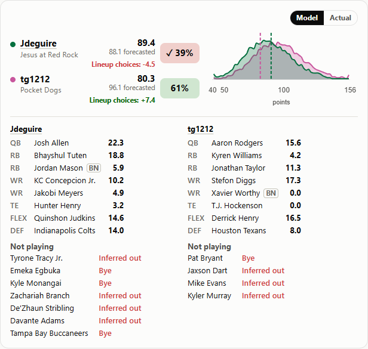
