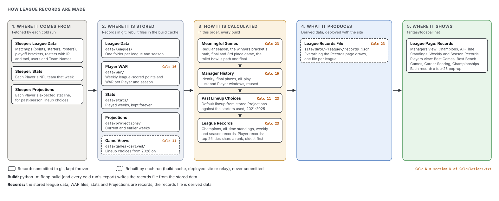

# How League Records Work

The League page's Records tab lists each league's bests and worsts: who won every title, the all-time
table, the biggest weeks and seasons, and the Players behind them. Every figure is computed from data
already stored for the league, at build time, into one file per league; the page only draws it. This
document follows the data from where it comes from to where it shows. The formulas are in
`Calculations.txt`. "Calc N" in the diagram and below means section N there.

- **Code:** `src/ffapp/league_records.py` (the league records and the export), `src/ffapp/views.py`
  (`season_lineup_choices`, lineup choices for past seasons), `site/league.js` (the page) and
  `site/people.js` (logos, avatars, Player photos and names, shared with the Managers page).
- **Runs:** `python -m ffapp build`, and the export at the end of every cold run, write
  `site/data/<league>/records.json`. See `docs/refresh-modes.md` for when cold runs happen.
- **Tests:** `tests/test_league_records.py` (the calculations), `tests/test_views.py` (past-season
  lineup choices) and `tests/layout/test_league_records_page.py` (the page in the browser).

## Diagram

Read it left to right. A solid box is a record, committed to git and kept forever. A dashed box is
rebuilt and never committed. The arrows in column 3 are the order of the calculations.

Redraw it after changing a source, a stored path, a calculation or what the Records page shows with
`python -X utf8 tools/league_records_diagram.py`. Its wording must match this document.

## 1. Where the Data Comes From

| Source | What it gives league records | Fetched |
|---|---|---|
| Sleeper: League Data | Matchups (team points, starters and rostered Players), playoff brackets, rosters with IR and taxi, users and Team Names | Every cold run |
| Sleeper: Stats | Each Player's NFL team in each week | Every cold run |
| Sleeper: Projections | Each Player's expected stat line, for past-season lineup choices | Every cold run, for the current and later weeks |

## 2. Where It Is Stored

| Data | Path | Tier |
|---|---|---|
| League data | `data/leagues/<league>/<season>/` | Record |
| Player WAR (Calc 16): weekly league-scored points and WAR | `data/war/<league>/<season>.json` | Record |
| Stats | `data/stats/<season>/week_NN.json` | Record |
| Projections | `data/projections/<season>/week_NN.json` | Record |
| Game views with lineup choices (Calc 11), from 2026 | `data/games-derived/<league>/<season>/` | Rebuilt |

## 3. How It Is Calculated

1. **Meaningful Games (Calc 23).** Only games that decide something count: the regular season, the
   winners bracket's games on the path to the championship, the championship and the 3rd place game,
   and in a toilet-bowl league the toilet bowl games on its path and its final. Consolation and other
   placement games are left out.
2. **Manager history (Calc 19).** Who held each roster (a vacant roster counts for its previous Manager),
   each season's final places (the winners bracket for the playoff teams; the toilet bowl, or in a league
   without one the regular-season standings, for the rest, so last place is last in the standings there), all-play luck and each Player's weeks on a team are
   reused from the Managers page's calculations, so the two pages agree.
3. **Past lineup choices (Calc 11, 23).** The game log behind lineup choices began in 2026. For 2021 to
   2025, each team's default lineup (its rostered Players with the highest Projections, no free agents)
   is rebuilt from that week's stored Projections and set against the starters used; an empty slot counts
   0. Those Projections are the last ones stored each week, so the values are close to, not exactly, what
   the game log would have frozen. Stored 2026 values made under an earlier rule are recomputed.
4. **League records (Calc 23).** Champions (with each champion's best Player by WAR on that roster), the
   all-time standings, eight weekly records, fourteen season records and four Player records. Each keeps
   its top 25; equal values share a rank and the oldest is listed first. Until it ends, the current season
   is left out of Fewest Points, Worst Record and the two playoff-line records.

## 4. What It Produces

| Output | Path | Tier |
|---|---|---|
| The league records file (Calc 23): Managers, champions, standings, weekly and season records with their top 25, and Player records for every position | `site/data/<league>/records.json` | Rebuilt (derived data, deployed with the site) |

## 5. Where It Shows

| Page | What it shows | Reads |
|---|---|---|
| League: Records, Managers view | Champions, All-Time Standings, Weekly Records (with game tags) and Season Records (with season results) | `site/data/<league>/records.json` |
| League: Records, Players view | Best Games, Best Bench Games, Career Scoring and Championships, filtered by position | `site/data/<league>/records.json` |
| Every record's pop-up | Its top 25 entries; on a phone, a sheet from the bottom of the screen | `site/data/<league>/records.json` |

## Keeping This Document Current

Change this document, the diagram's generator and `Calculations.txt` section 23 together whenever a source,
a stored path, a league record's calculation or what the Records page shows changes.
