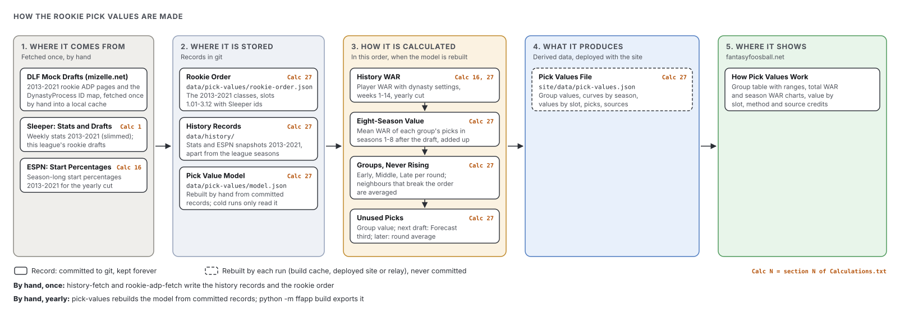

# How the Rookie Pick Values Work

The rookie pick values say what a dynasty rookie pick has been worth: the WAR its Players produced over
the eight seasons after their draft, by round and third of the round. Thirteen rookie classes give the
history, valued with this site's own Player WAR. The values feed the Trades tab, where a pick not used
yet counts its pick value, and the "How Pick Values Work" page shows and explains them. The model is
built by hand from committed records and kept as a record; every build exports it for the site.
"Calc N" means section N of `Calculations.txt`.

- **Code:**
  - `src/ffapp/pick_values.py`: the history store and history WAR, the rookie orders, the model, the
    value of an unused pick, the record and the export.
  - `src/ffapp/mizelle.py`: the 2013–2021 rookie order from the cached DLF pages.
  - `site/pick-values.html` and `site/pick-values.js`: the page.
- **Runs:**
  - `python -m ffapp history-fetch`, by hand and once: Sleeper's weekly stats (slimmed) and ESPN's
    season start percentages for 2013–2021 into `data/history/`.
  - `python -m ffapp rookie-adp-fetch`, by hand and once: caches the mizelle.net pages and the
    DynastyProcess ID map locally (never committed), then writes the committed rookie order record
    `data/pick-values/rookie-order.json`.
  - `python -m ffapp pick-values`, by hand once a year after a season ends: rebuilds
    `data/pick-values/model.json` from committed records alone. No cold run calls any of the three.
  - `python -m ffapp build`, and every cold run's export, write `site/data/pick-values.json`.
- **Tests:**
  - `tests/test_pick_values.py`: the history records and WAR, the rookie orders, the model, unused
    picks, the record and the export.
  - `tests/layout/test_pick_values_page.py`: the page in the browser.

## Diagram

Read it left to right. A solid box is a record, committed to git and kept forever. A dashed box is
rebuilt and never committed. The arrows in column 3 are the order of the calculations.

Redraw it after changing a source, a stored path, a calculation or what the page shows with
`python -X utf8 tools/pick_values_diagram.py`. Its wording must match this document.

## 1. Where the Data Comes From

| Source | What it gives the pick values | Fetched |
|---|---|---|
| DLF mock drafts (mizelle.net) | Each 2013–2021 rookie's picks in Dynasty League Football startup mock drafts, month by month, with his MFL id; DynastyProcess's ID map links MFL ids to Sleeper ids | Once, by hand, into the local cache `.cache/third-party/` |
| Sleeper: stats and drafts (Calc 1) | Weekly stats for 2013–2021, slimmed to the fields scoring and WAR read; this league's rookie drafts | History stats once, by hand; drafts every cold run |
| ESPN: start percentages (Calc 16) | Each 2013–2021 season's season-long start percentages, for WAR's yearly cut | Once, by hand |

## 2. Where It Is Stored

| Data | Path | Tier |
|---|---|---|
| The 2013–2021 rookie order (Calc 27): slots 1.01–3.12 of each class with Sleeper ids | `data/pick-values/rookie-order.json` | Record, written once |
| History records: stats and ESPN snapshots, 2013–2021 | `data/history/` | Record, written once |
| The pick value model (Calc 27): model and measured values, ranges, curves, values by slot | `data/pick-values/model.json` | Record, rebuilt by hand once a year |

The pages and the ID map stay in the local cache and are never committed. Only the ranking taken from
them is published, with credit on the page.

## 3. How It Is Calculated

1. **History WAR (Calc 16, 27).** The 2013–2021 seasons run through the unchanged Player WAR code with
   the dynasty league's scoring and lineup, weeks 1 to 14 and the season-long start percentages. On the
   2022–2025 seasons this method reproduces the stored WAR exactly.
2. **Rookie order (Calc 27).** A 2013–2021 class is ranked by each rookie's average pick in the mock
   drafts held from May to August, after the NFL draft. From 2022 the classes are this league's own
   rookie drafts; 2022 uses the startup draft's rookies in pick order.
3. **Eight-season value (Calc 27).** For each group, the average WAR of its picks in each of the eight
   seasons after the draft, over the classes that have reached that season, added up.
4. **Groups that never rise (Calc 27).** Picks 1–4, 5–8 and 9–12 of each round form the Early, Middle
   and Late groups. Where a group is worth more than the one before it, the two are averaged.
5. **Unused picks (Calc 27).** A pick whose draft order is set takes its group's value. A pick in the
   next draft takes the third of the round its team's place in the current Forecast gives it. A pick
   further away takes its round's average.

### The Values (2013–2025 classes, through the 2025 season)

| Pick | Early | Middle | Late |
|---|---|---|---|
| 1st | +3.38 | +1.45 | +0.11 |
| 2nd | −0.75 | −0.75 | −0.75 |
| 3rd | −1.03 | −1.05 | −1.05 |

Rounds 2 and 3 are below zero because WAR counts bench weeks: rookies taken there play and score below
replacement level more often than they help.

## 4. What It Produces

| Output | Path | Tier |
|---|---|---|
| The pick values file (Calc 27): group values with ranges, each group's WAR by season, the rounds' WAR by season, values by slot, picks and sources | `site/data/pick-values.json` | Rebuilt (derived data, deployed with the site) |

## 5. Where It Shows

| Page | What it shows | Reads |
|---|---|---|
| How Pick Values Work (linked from every league page's footer) | The group table, total WAR over eight seasons by round, WAR in each season, value by slot, each chart with a table view, and the method with source credits | `site/data/pick-values.json` |
| League: Trades (change `league-trades`) | Each unused pick's value and basis | `site/data/pick-values.json` |

## Keeping This Document Current

Change this document, the diagram's generator and `Calculations.txt` section 27 together whenever a
source, a stored path, a pick value calculation or what the page shows changes. After each season,
run `python -m ffapp pick-values`, commit the new model, and update the values table above.
