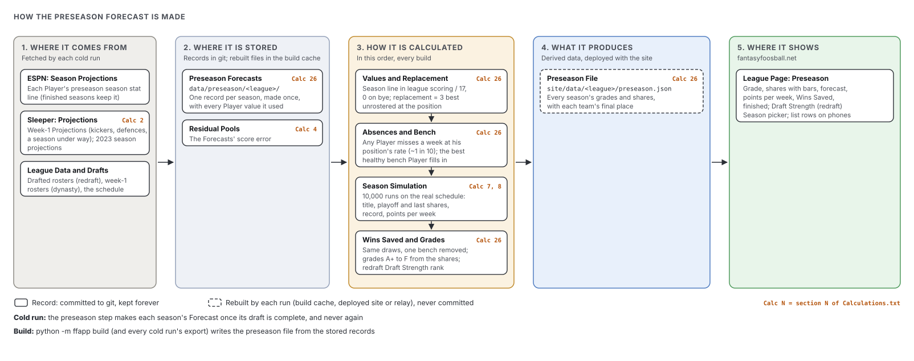

# How the Preseason Forecast Works

The League page's Preseason tab shows, for every season, the Forecast made once right after the draft:
every team's drafted roster played through the real schedule, each Player valued from his preseason
projection, with any Player able to get hurt in any week and the best healthy bench Player stepping in.
Each team gets title, playoff and last-place shares, a grade from A+ to F, the wins its bench saves and,
for finished seasons, where it actually finished. Every figure is computed into a record when the draft
completes and exported for the page; the page only draws it. "Calc N" means section N of
`Calculations.txt`.

- **Code:**
  - `src/ffapp/preseason.py`: values, matching, rosters, absences, Wins Saved, grades, the record and export.
  - `src/ffapp/simulate.py`: the season simulation, with the `scores_for_week` hook.
  - `src/ffapp/espn.py`: the season projections request.
  - `site/preseason.js`: the tab.
  - `site/league.js`: the League sub-tab's tabs and URL.
- **Runs:**
  - The cold run's `preseason` step makes each league-season's Forecast once, at the first run after its
    draft is complete.
  - `python -m ffapp preseason` does the same by hand.
  - `python -m ffapp build`, and every cold run's export, write `site/data/<league>/preseason.json`.
- **Tests:**
  - `tests/test_preseason.py`: the calculations, record and export.
  - `tests/test_colour_contrast.py`: the grade badges and share bars.
  - `tests/layout/test_preseason_page.py`: the tab in the browser.

## Diagram

Read it left to right. A solid box is a record, committed to git and kept forever. A dashed box is
rebuilt and never committed. The arrows in column 3 are the order of the calculations.

Redraw it after changing a source, a stored path, a calculation or what the Preseason tab shows with
`python -X utf8 tools/preseason_diagram.py`. Its wording must match this document.

## 1. Where the Data Comes From

| Source | What it gives the Preseason tab | Fetched |
|---|---|---|
| ESPN: Season Projections | Each Player's preseason season stat line. Finished seasons keep the preseason line, even for Players hurt early | When a season's Forecast is made |
| Sleeper: Projections (Calc 2) | Week-1 Projections for kickers, defences and any season already under way; 2023's season projections, whose ESPN lines are blank for many top Players | Week-1 Projections are records; 2023 season projections when its Forecast is made |
| League Data and Drafts | Drafted rosters (redraft), week-1 rosters without taxi Players (dynasty), the season's schedule and brackets | Every cold run |

## 2. Where It Is Stored

| Data | Path | Tier |
|---|---|---|
| Preseason Forecasts (Calc 26): grades, shares, Wins Saved, and every Player value, source and roster used | `data/preseason/<league>/<season>.json` | Record, written once |
| Week-1 Projections (Calc 2) | `data/projections/<season>/week_01.json` | Record |

## 3. How It Is Calculated

1. **Values and replacement level (Calc 26).**
   - **Value:** each Player's season line, scored with that league-season's scoring and divided by 17,
     and 0 in his team's bye week.
   - **Matching:** ESPN Players are matched to Sleeper Players by name, with suffixes such as "III"
     dropped, and position.
   - **Replacement level:** the mean value of the 3 best unrostered Players at each position. A team
     with no kicker or defence plays that level.
2. **Absences and the bench (Calc 26).** In every simulated week, any rostered Player misses the game
   at his position's rate: QB 10.6%, RB 11.9%, WR 11.4%, TE 10.2%, K 4.4%, DEF 0%. Slots are filled with
   the best healthy Player worth at least replacement level, else replacement level.
3. **The season simulation (Calc 7, 8).** 10,000 runs on the real schedule, scored with the Forecasts'
   score error, and seeded and bracketed as in the Forecasts.
4. **Wins Saved, grades and Draft Strength (Calc 26).**
   - **Wins Saved:** a team's mean wins minus its wins on the same draws with only its own injured
     starters at replacement level.
   - **Grades:** from the title, playoff and last-place shares, in the order A, then B, then F, then C,
     then D, with plus and minus near each band's edges.
   - **Draft Strength (redraft):** each team's rank by preseason points per week.

### How Well It Has Predicted (backtest, 2026-11-27)

| League | Preseason points per week vs actual | Slope | Spread of preseason / actual points per week |
|---|---|---|---|
| Dynasty | correlation 0.55 | 1.02 | 7.1 / 11.0 |
| Redraft | correlation −0.13 | −0.72 | 2.1 / 8.8 |

**Dynasty** grades have held up: two A teams won titles, and five of seven F teams finished 11th or 12th.
**Redraft** drafts come out nearly even, and the season has been decided by injuries, moves and luck, so
redraft grades should be read as the draft on paper. A redraft revision built on positional and
starter/bench draft rankings is in the backlog.

## 4. What It Produces

| Output | Path | Tier |
|---|---|---|
| The preseason file (Calc 26): Managers, and for every season with a Forecast each team's grade, shares, record, points per week, Wins Saved, Draft Strength (redraft) and final place (finished seasons) | `site/data/<league>/preseason.json` | Rebuilt (derived data, deployed with the site) |

## 5. Where It Shows

| Page | What it shows | Reads |
|---|---|---|
| League: Preseason | Grade, Manager, Title, Playoffs and Last shares with bars, Forecast record, Pts/Wk, Draft Strength (redraft), Wins Saved and Finished, sortable, with a Season picker, the grade key and the method note. On phones, one row per team | `site/data/<league>/preseason.json` |

## Keeping This Document Current

Change this document, the diagram's generator and `Calculations.txt` section 26 together whenever a
source, a stored path, a preseason calculation or what the Preseason tab shows changes.
