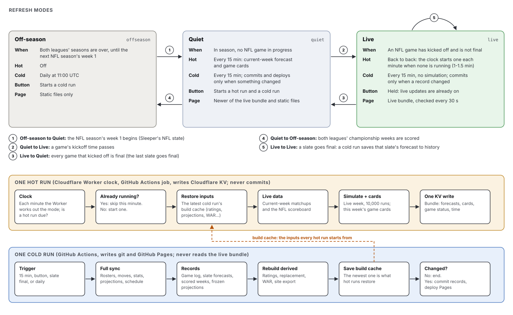

# Refresh Modes

The site's data refreshes in two kinds of run, and how often each one runs depends on one of three modes.

- **Hot runs** keep what changes minute to minute current: this week's live scores, the live forecast and
  this week's game cards. A hot run writes one bundle to Cloudflare KV and never commits or deploys anything.
- **Cold runs** keep the durable data: rosters, moves, stats, schedule, the game log and the records. A
  cold run rebuilds everything derived from them, commits only the records, and deploys the site only when
  something changed.

A Cloudflare Worker (the refresh relay, `relay/worker.js`) is the clock. Every minute it works out the mode
and starts whichever runs are due. GitHub Actions does the work, because the simulation needs more CPU time
than a Worker has.

- **Mode and timing:** `relay/worker.js` (`mode()`, and `tick()`, which the cron trigger runs each minute).
- **Runs:** `.github/workflows/hot.yml` (`python -m ffapp hot`) and `.github/workflows/refresh.yml`
  (`python -m ffapp refresh`).
- **Page side:** `site/updates.js` (reads the live bundle) and `site/refresh.js` (the Refresh Data button).
- **Tests:** `relay/worker.test.mjs` (every mode and transition, the button), `tests/test_hot.py` (the
  bundle), `tests/test_storage_tiers.py` (what is committed and what is rebuilt).

## Diagram

The top half shows the three modes and their numbered transitions. The bottom half shows the steps of
one hot run and one cold run. The dashed arrow is the build cache: the cold run's rebuilt files, which
every hot run starts from.

Redraw it after changing a mode, a trigger or a run's steps with
`python -X utf8 tools/refresh_modes_diagram.py`. Its wording must match this document.

## Modes

| Mode | Code | True when | Hot runs | Cold runs | Refresh Data button | Page reads |
|---|---|---|---|---|---|---|
| Off-season | `offseason` | Both leagues' seasons are over, until the NFL season's week 1 begins | Off | Daily at 11:00 UTC | Starts a cold run | Static files only |
| Quiet | `quiet` | In season; no NFL game in progress | Every 15 min | Every 15 min | Starts a hot run and a cold run | The newer of the live bundle and the static files, checked every 60 s |
| Live | `live` | An NFL game has kicked off and is not final | Back to back: the clock starts one each minute when none is running, so about every 1 to 1.5 min | Every 15 min, without the simulation, plus one when a slate goes final | Held: "Live updates on" | The live bundle, checked every 30 s |

In every mode a cold run commits only when a record changed and deploys the site only when the commit or
the rebuilt site changed. Most cold runs in Live and Quiet end without either.

**Why hot runs also run in Quiet:** the current week's forecast moves before kickoff, as projections update
and players are ruled out (inactives come out about 90 minutes before each game).

**Why cold runs are not back to back in Live:** rosters lock as players kick off, so the durable data
barely changes during games. Back-to-back cold runs would commit and deploy 30 or more times an hour,
growing the history and going past GitHub Pages' soft limit of about 10 deploys an hour.

## Transitions

| # | From → to | Trigger |
|---|---|---|
| 1 | Off-season → Quiet | The NFL season's week 1 begins, as Sleeper's NFL state reports it |
| 2 | Quiet → Live | A game's kickoff time passes |
| 3 | Live → Quiet | Every game that kicked off is final: the last slate goes final |
| 4 | Quiet → Off-season | Both leagues' championship weeks are scored |
| 5 | Live → Live | A slate goes final while later games are still to finish or still to start: a cold run saves that slate's forecast to history |

A **slate** is the set of games that kick off at the same time (for example, Sunday's 1:00 pm games).

The Worker decides the mode from two things it already holds, so the clock never calls Sleeper or ESPN
itself:

- **The schedule summary:** each game's kickoff time, and whether each league's season is over. The cold
  run writes it to KV after its schedule step.
- **The last bundle's game status:** which games the latest hot run saw in progress or final.

A game counts as in progress from its kickoff time until a hot run sees it final. A game the hot runs have
not yet seen final more than 6 hours after its kickoff counts as final, so a stuck status cannot keep
the site in Live.

## One Hot Run

1. **Clock:** each minute, the Worker works out the mode and whether a hot run is due.
2. **Already running?** If a hot run is queued or in progress, it skips this minute. Otherwise it starts
   `hot.yml`.
3. **Restore inputs:** the job checks out `main` and restores the latest cold run's build cache: ratings,
   replacement levels, WAR, future-week projections and the exported site. If the cache is missing, it
   rebuilds them offline from the committed records (about 20 seconds more).
4. **Live data:** current-week matchups and the NFL scoreboard.
5. **Simulate and cards:** the live week's forecast (10,000 runs) and this week's game cards, for both
   leagues.
6. **One KV write:** one bundle holding, per league, the forecast file and this week's game cards as the
   page reads them, plus each game's status and the run's time.

A hot run writes nothing to git and deploys nothing. A failed hot run leaves the previous bundle in place.
The page keeps showing it until a newer bundle or newer static files arrive.

## One Cold Run

1. **Trigger:** every 15 minutes in Quiet and Live, the button, a slate going final, or the daily run.
2. **Full sync:** rosters, transactions, stats, projections, the NFL schedule, injury statuses and the
   start-percentage snapshot.
3. **Records:** this week's game log entries; in Live, the forecast of each slate that went final; the
   prediction of record for a newly scored week.
4. **Rebuild derived:** ratings, replacement levels, WAR, the game files' forecast and view parts, and the
   site export. In Live the cold run skips the simulation: the hot runs own the live forecast.
5. **Save the build cache:** under a key for this run (`build-<run>`); hot runs, the next cold run and
   the code deploy restore the newest one.
6. **Changed?** If no record changed and the rebuilt site matches what is deployed (ignoring timestamps),
   the run ends. Otherwise it commits the records and deploys the site.

The cold run never reads the live bundle. It takes the truth from Sleeper and ESPN.

## Where Data Lives

| Tier | Where | Kept | Written by | Contents |
|---|---|---|---|---|
| Live | Cloudflare KV, one key | Latest only, overwritten each hot run; expires after 7 days | Hot run | The live bundle |
| Records | git, `data/` | Forever | Cold run, only on change | See "Committed" |
| Derived | GitHub Actions cache, and the deployed site | Rebuilt each cold run. GitHub evicts a cache entry unused for 7 days | Cold run (and the code-push deploy) | See "Rebuilt, Never Committed" |

### Committed

- League data: rosters, users, matchups, brackets, transactions, and each season's draft with its
  picks and traded picks (`data/leagues/<league>/<season>/draft.json`, fetched until complete, then
  kept).
- Sleeper's preseason ADP for each season, half-PPR and dynasty half-PPR (`data/adp/`), stored once
  when every league's draft for the season is complete.
- nflverse's weekly injury history for each season from 2021 (`data/injury-reports/`): each fantasy
  Player's IR, PUP and Out weeks by Sleeper id, for the draft grades' Unlucky picks. Completed seasons
  are fetched once, the current season at most once every 20 hours (the fetch times are rebuilt data
  in `data/refresh/`).
- Stats for played weeks (`data/stats/`), injury statuses (`data/injuries/`), player details
  (`data/players/`), trending (`data/trending/`), ESPN snapshots and the crosswalk (`data/espn/`).
  Trending and the ESPN snapshots are running tallies: every cold run fetches them and the site shows
  the latest, but git keeps one copy a day, from the first cold run after midnight UTC
  (`ffapp hold-tallies`). A projection or stat that differs only in Sleeper's `last_modified` time is
  not a change.
- The NFL schedule (`data/nfl/`): each game's teams, kickoff and state, and its score once final. The
  fetch time and live clocks and scores are rebuilt data, so a game in progress is not a new record.
- Projections for the current week and every earlier week (`data/projections/`).
- The forecast of record for each completed as-of week (`data/odds/<league>/<season>/asof_NN.json`), and
  each slate's forecast in Live (`data/odds/<league>/<season>/slates_NN.json`).
- Each game file's log and prediction of record (`data/games/<league>/<season>/week_NN.json`, keys `log`
  and `record`). The log covers the current week only.
- The calibration report and rows (`data/calibration/`), which change only when run by hand.

### Rebuilt, Never Committed

Each item lists what reads it, and confirms nothing durable depends on it.

| Data | Rebuilt from | Read by |
|---|---|---|
| `site/data/**` | Everything below and the records | The site only |
| Ratings (`data/ratings/`) | Committed league data | Export, manager pages |
| Replacement levels (`data/replacement/`) | Committed stats and league data | WAR, game views, export |
| WAR (`data/war/`) | Committed stats, league data and replacement levels | Export, manager pages, positions |
| Future-week projections (`data/projections-future/`) | Sleeper, each cold run (without them the simulation uses the latest stored week and says so) | The simulation |
| The live forecast (`data/odds/<league>/<season>/live.json`) | The simulation | Export; in Live the bundle carries it |
| Game files' `forecast`, `views` and `baseline` (`data/games-derived/`) | The log, records and simulation | Export |
| The roster-drift model (`data/model/`) | Committed league data, at each simulation | Nothing reads it back; it shows the fitted values |
| The latest scoreboard, with fetch time and live clocks (`data/nfl-live/`) | ESPN, each run | The live simulation and game cards |
| The last-run time, schedule summary and site hash (`data/refresh/`) | Each run | Export (the "Updated" time); the relay's clock; the deploy decision |

The store reads a game file as its record part merged with its rebuilt part, and a week's
projections from `data/projections/` before `data/projections-future/`, so the code that reads them
does not need to know which tier a file is in. `DERIVED_PATHS` in `src/ffapp/store.py` lists the
rebuilt paths, and `.gitignore` matches it.

Their history from before this change stays in git; it is not rewritten.

### Running the Site Locally

Since `site/data` is no longer in git, build it with `python -X utf8 -m ffapp build` before opening the
site. It rebuilds the derived data offline from the committed records. With no run on record, the
site's "Updated" time is the last commit to `data/`, so the page still ignores a live bundle older
than that. Future-week projections can't be fetched offline, so points per game and forecasts can
differ slightly from the published site. `python -m ffapp refresh` also
builds it, after fetching new data.

## Limits and Budgets

| Limit | Allowance | Use at most |
|---|---|---|
| Cloudflare KV writes (free plan) | 1,000 a day | About 500 on a full Sunday: about 450 hot runs in Live, about 50 in Quiet, plus button presses |
| Cloudflare Worker requests and KV reads (free plan) | 100,000 a day each | The clock (1,440 a day) plus page checks; a page that already has the latest bundle gets an empty answer |
| GitHub API (the Worker's token) | 5,000 an hour | About 60 an hour: one "is a run going?" check a minute when a run is due |
| GitHub Pages deploys | About 10 an hour (soft) | Cold runs deploy only on change: a few an hour at most |
| Sleeper API | 1,000 calls a minute | About 8 calls a hot run, about 500 an hour in Live |
| GitHub Actions minutes | Free for a public repository | |

## When Something Fails

| Failure | What happens |
|---|---|
| The Worker's clock stops | GitHub's own daily schedule still starts the 11:00 UTC cold run, so the site is never more than a day old |
| A hot run fails | The previous bundle stays. The next minute's clock starts another hot run |
| A cold run fails | Nothing is committed or deployed. The previous site and build cache stay; the next cold run tries again |
| The bundle is older than the static files | The page ignores it |
| KV's daily write limit is reached | Hot runs stop writing until the limit resets at 00:00 UTC; cold runs carry on |

## Keeping This Document Current

- Change this document, the diagram's generator and the specs together whenever a mode, a trigger, a
  cadence, a run's steps or a data tier changes.
- `tests/test_storage_tiers.py` fails when a path listed under "Rebuilt, Never Committed" is tracked by git,
  or when the build from committed records alone does not produce the site.
- Review "Limits and Budgets" when Cloudflare, GitHub or Sleeper change their allowances, and at the start
  of each season.
