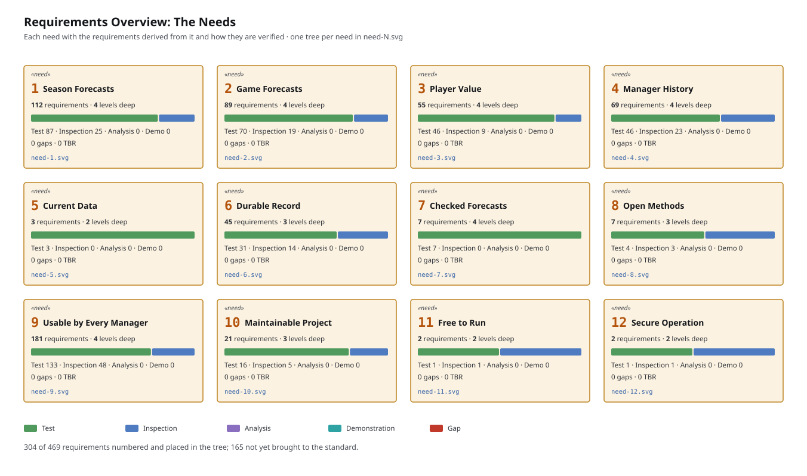

# How the Requirements Work

Every behavior the project promises is written as a requirement in a spec under `openspec/specs/`.
The requirements follow the NASA Systems Engineering Handbook, Appendix C ("How to Write a Good
Requirement"): each states one thing with one SHALL, in verifiable words, with tolerances on its
values. Each traces up to a need, the top level that says what the app is for, and down to the test
or inspection that verifies it. This document explains the tree, how to read the diagrams, and how
the check keeps it all true.

- **Code:** `tools/requirements_model.py` (the parser and the check's rules),
  `tools/requirements_impact.py` (what a change to one requirement may affect) and
  `tools/requirements_diagram.py` (the diagrams).
- **Records:** the specs in `openspec/specs/` (the needs are in `openspec/specs/needs/spec.md`),
  `openspec/glossary.md` (terms and banned terms), `openspec/inspection-checklist.md` (dated
  inspections) and `openspec/retired-requirements.md` (IDs never to be reused).
- **Tests:** `tests/test_requirements.py`, with today's gaps in `tests/baselines/requirements.json`
  and the open items in `tests/baselines/requirements_open.json`; both may only shrink.

## Diagram



The overview shows each need with the number of requirements derived from it, how many levels deep
they go, and how they are verified. The bar's colours are Test, Inspection, Analysis, Demonstration
and Gap (no verification yet).

Each need also has its own tree, `images/requirements/need-N.svg` (for example
[need 1](images/requirements/need-1.svg) and [need 10](images/requirements/need-10.svg)). The trees
use SysML requirement-diagram notation:
- the need sits at level 0 on the left, and each level of derived requirements has its own column;
- each box is a «requirement» with its ID, name, statement and spec, and an orange TBR badge if it
  has an open item; "proposed" marks a requirement still in an active change;
- a dashed «deriveReqt» arrow runs to the requirement's primary parent, which sets its ID;
- a dotted «trace» arrow runs to each extra parent, drawn faded below the tree when it belongs to
  another need's branch;
- a «verify» arrow comes from the test case, inspection or analysis that verifies it, or from a red
  gap.

Redraw them after any spec change with `python -X utf8 tools/requirements_diagram.py`. The
feature-docs check fails until the committed diagrams match the specs.

## 1. Where the Requirements Come From

The specs are written in OpenSpec changes: a change proposes new or changed requirements in its own
delta specs, and archiving it merges them into `openspec/specs/`. The check and the diagrams read
both the main specs and the delta specs of active changes, so a proposal is checked before it is
merged.

The needs are the level-0 requirements in `openspec/specs/needs/spec.md`. A requirement that traces
to nothing (an orphan) shows either a need that is missing or a requirement no one needs.

## 2. How a Requirement Is Written

```
### Requirement: 1.1.2 Real schedule
The simulation SHALL use each league's Sleeper matchup pairings for every remaining regular-season week.

**Rationale:** (only where the reason is not evident)
**Traces to:** 1.1
**Verified by:** Test: `tests/test_simulate.py::test_uses_real_pairings`
**TBR:** (only for an open item: rationale, what closes it, target date)
```

- **ID:** a need is numbered 1, 2, 3 and so on. A requirement derived from it takes its primary
  parent's ID plus the next unused number: 1.1, then 1.1.2, then 1.1.2.1. The number of dots is the
  level. An ID is never reused; a cut or renumbered requirement's old ID goes in
  `openspec/retired-requirements.md`.
- **Traces to:** one or more parent IDs, separated by semicolons, primary parent first. A trace is
  an association: it says which higher requirements a change to this one may affect. More than three
  parents usually means a compound requirement or overlapping parents, and is reported unless
  accepted with a reason in `tests/baselines/requirements_accepted.json`.
- **Verified by:** Test (a test function that exists), Analysis (a report and section), Inspection
  (a row in `openspec/inspection-checklist.md`) or Demonstration (a procedure in `docs/`). A
  requirement with no evidence yet says `Gap:` and what would verify it. Needs say `Children`: a
  need is verified when its children are.
- **Words:** the terms in `openspec/glossary.md` mean what it says, and its Banned Terms (such as
  "fast", "robust", "etc." and the retired nomenclature) are not allowed in statements.

## 3. How It Is Checked

`tests/test_requirements.py` runs `tools/requirements_model.py` over every requirement and reports:
- more or fewer than one SHALL, or a SHALL NOT;
- a banned term;
- a missing, duplicate or retired ID, or one that does not follow its primary parent;
- a missing parent, a cycle, or a chain that never reaches a need;
- more than three parents, unless accepted;
- a missing Verified by, an unknown method, a test that does not exist, or an Inspection with no
  checklist row;
- a TBR with no target date;
- a need with no children, and a glossary term no spec uses;
- a spec with no dated standard review, or one edited in a commit after its review date;
- an inspection whose requirement, or any requirement beneath it, changed after the inspection
  date.

Judgment items a parser cannot see (tolerances, rationale, undefined terms) are checked by the
maintainer in each spec's standard review, dated in `openspec/inspection-checklist.md`. Editing a spec
makes its review out of date, and the check fails until it is reviewed again. CI checks out a single
commit, so the date rule runs on full clones only.

Before editing a requirement, run `python -X utf8 tools/requirements_impact.py <ID>` to list every
requirement above and below it, with how each is verified.

## 4. Where It Shows

The diagrams appear only in this document; the requirements are not shown on the site.

## Keeping This Document Current

The diagrams are drawn from the specs, so any spec change needs a redraw in the same change, and
the feature-docs check enforces it. Change this document, `tools/requirements_model.py` and the
`project-standards` spec together whenever a rule of the standard changes.
