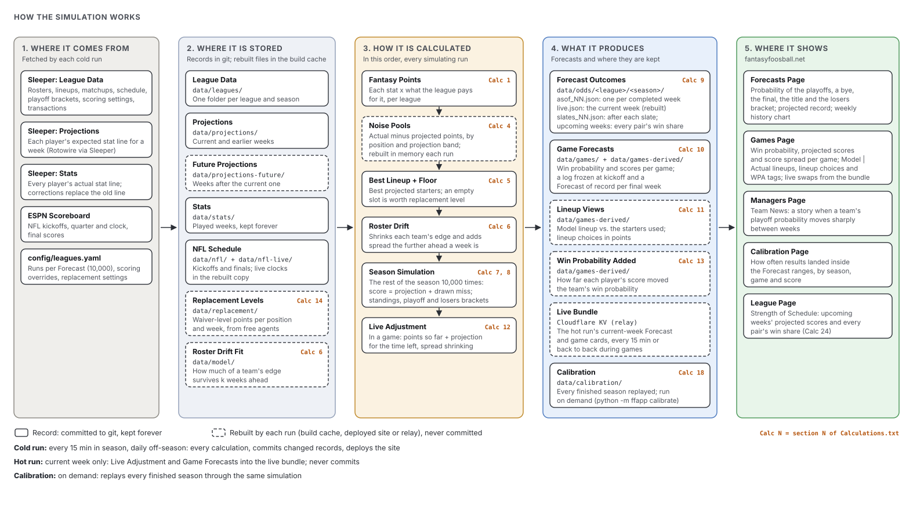

# How the Simulation Works

Every Forecast on the site comes from one simulation. It plays the rest of the season 10,000 times on
each league's real schedule, starting from Sleeper's Projections, and counts how often each outcome
happens. This document follows the data from where it comes from to where it shows on the site. The
formulas are in `Calculations.txt`. "Calc N" in the diagram and below means section N there.

- **Code:** `src/ffapp/simulate.py` (the runs), `src/ffapp/odds.py` (season Forecasts),
  `src/ffapp/forecast.py` and `src/ffapp/games.py` (game Forecasts), `src/ffapp/live.py` (games in
  progress).
- **Runs:** each cold run simulates after it syncs (`python -m ffapp refresh`), and each hot run simulates
  the current week (`python -m ffapp hot`). See `docs/refresh-modes.md` for when each one runs.
- **Tests:** `tests/test_simulate.py`, `tests/test_odds.py`, `tests/test_live.py`, and the calibration
  report (`data/calibration/report.md`), which checks the Forecasts against what happened.

## Diagram

Read it left to right. A solid box is a record, committed to git and kept forever. A dashed box is
rebuilt by each run and never committed. The arrows in column 3 are the order of the calculations.

Redraw it after changing a source, a stored path, a calculation or a feature that shows Forecasts with
`python -X utf8 tools/simulation_diagram.py`. Its wording must match this document.

## 1. Where the Data Comes From

| Source | What it gives the simulation | Fetched |
|---|---|---|
| Sleeper: League Data | Rosters, lineups, matchups, the schedule, playoff brackets, scoring settings and transactions | Every cold run |
| Sleeper: Projections | Each player's expected stat line for a week (Rotowire via Sleeper) | Every cold run, for the current and later weeks |
| Sleeper: Stats | Every player's actual stat line, free agents included | Every cold run; a correction replaces the old line |
| ESPN Scoreboard | NFL kickoffs, each game's quarter and clock, and final scores | Every cold and hot run |
| `config/leagues.yaml` | Runs per Forecast (10,000), scoring overrides and replacement settings | Read at start |

Player statuses (Out, Doubtful, IR) are fetched too, but they are not a simulation input. A player listed
Out is benched in the simulation only once the Projection drops (Calc 3). The statuses drive the Games
cards' "Not playing" list instead.

## 2. Where It Is Stored

Everything is under `data/`. Records are committed only when they change. Rebuilt files are carried
between runs in the GitHub Actions build cache (see `docs/refresh-modes.md`, "Where Data Lives").

| Data | Path | Tier |
|---|---|---|
| League data | `data/leagues/<league>/<season>/` | Record |
| Projections, current and earlier weeks | `data/projections/<season>/week_NN.json` | Record |
| Projections, later weeks | `data/projections-future/<season>/week_NN.json` | Rebuilt |
| Stats | `data/stats/<season>/week_NN.json` | Record |
| NFL schedule | `data/nfl/` (kickoffs, states, finals) and `data/nfl-live/` (live clocks) | Record, and rebuilt |
| Replacement levels (Calc 14) | `data/replacement/<league>/<season>.json` | Rebuilt |
| Roster drift fit (Calc 6) | `data/model/<league>.json` | Rebuilt |

The noise pools (Calc 4) are not stored. Each run builds them in memory from every stored week's
Projections and Stats.

## 3. How It Is Calculated

Each simulating run does these steps in order.

1. **Fantasy points (Calc 1).** Each stat line, projected or actual, is scored by its own league's
   settings. One stored copy serves both leagues.
2. **Noise pools (Calc 4).** Every past miss (actual points minus projected points) is pooled by position
   and projection band. A simulated score is a player's Projection plus a miss drawn from that player's pool, so
   busts and booms happen as often as they really do.
3. **Best lineup and the replacement floor (Calc 5, 14).** Each team starts its best projected lineup. An
   empty slot from a bye, an injury or a thin bench is worth what a waiver pickup would score, not zero.
4. **Roster drift (Calc 6).** Rosters change, so only part of a team's edge survives several weeks ahead.
   The fit says how much survives, and how much random change piles up, k weeks out.
5. **Season simulation (Calc 7, 8).** The rest of the regular season is played 10,000 times. Each run
   builds the final standings and plays the playoff and losers brackets the way each league's Sleeper
   settings play them. Only six-team brackets are supported: a league whose settings give another
   playoff size stops the run with an error naming the league, season and size
   (`src/ffapp/odds.py`, `build_inputs`), so no wrong Forecast is published.
6. **Live adjustment (Calc 12).** During a week, a player whose game has started scores the points so far
   plus the Projection for the time left, with the spread shrinking as the game runs out.

The hot run does steps 1 to 6 for the current week only. Cold runs during games skip the simulation
(the hot runs own the live Forecast), then simulate afresh when a slate goes final.

## 4. What It Produces

| Output | Path | Tier |
|---|---|---|
| Forecast outcomes (Calc 9): the share of runs in which each team makes the playoffs, gets a bye, reaches the final, wins the title, lands in the losers bracket or finishes last; projected record | `data/odds/<league>/<season>/asof_NN.json`, one per completed week | Record |
| The current week's Forecast | `data/odds/<league>/<season>/live.json` | Rebuilt |
| Slate Forecasts: the Forecast after each slate of games goes final | `data/odds/<league>/<season>/slates_NN.json` | Record |
| Game Forecasts (Calc 10): win probability, projected scores and the score spread per game; a log frozen at kickoff; the Forecast of record per final week | `data/games/` (log and record) and `data/games-derived/` (the rest) | Record, and rebuilt |
| Lineup views (Calc 11): the model's best lineup against the starters used, and lineup choices in points against the roster's highest Projections | `data/games-derived/` | Rebuilt |
| Win probability added (Calc 13): how far each player's score moved the team's win probability | `data/games-derived/` | Rebuilt |
| The live bundle: the hot run's current-week Forecast and game cards | Cloudflare KV, through the refresh relay | Rebuilt |
| Calibration (Calc 18): every finished season replayed through the same simulation | `data/calibration/report.json` and `report.md` | Record, run on demand (`python -m ffapp calibrate`) |

## 5. Where It Shows

| Page | What it shows from the simulation | Reads |
|---|---|---|
| Forecasts | The probability of each outcome per team, the projected record and the weekly history chart | `site/data/<league>.json` |
| Games | Each game's win probability, projected scores and score spread; Model and Actual lineups; lineup choices; WPA tags; live updates from the bundle | `site/data/<league>/games/` |
| Managers | Team News stories when a team's playoff probability moves sharply between weeks | `site/data/<league>/managers.json` |
| Calibration | How often results landed inside the Forecast ranges, by season, game and score | `site/data/calibration.json` |

During a week, open pages read the live bundle from the relay every 30 to 60 seconds and swap in the
newer copy of the Forecasts and Games files (`site/updates.js`).

## Keeping This Document Current

Change this document, the diagram's generator and `Calculations.txt` together whenever a source, a stored
path, a calculation or a feature that shows Forecasts changes.
