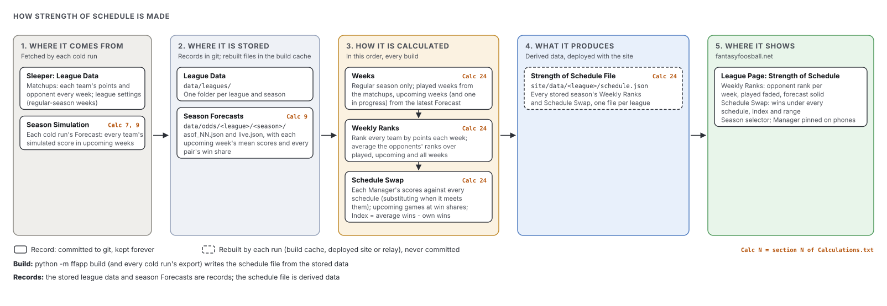

# How Strength of Schedule Works

The League page's Strength of Schedule tab shows how hard each Manager's regular-season schedule is, two
ways. **Weekly Ranks** asks how good the opponents were: each week every team is ranked by points, and a
Manager is credited with their opponent's rank. **Schedule Swap** asks what the schedule cost them: their
own weekly scores are played against every other Manager's schedule. Every figure is computed at build
time into one file per league; the page only draws it. This document follows the data from where it
comes from to where it shows. The formulas are in `Calculations.txt`. "Calc N" in the diagram and below
means section N there.

- **Code:** `src/ffapp/schedule_strength.py` (the figures and the export), `src/ffapp/simulate.py`
  (`upcoming_pairings`, each upcoming week's mean scores and pair win shares in the season Forecast),
  `site/schedule.js` (the tab) and `site/league.js` (the League sub-tab's tabs and URL).
- **Runs:** `python -m ffapp build`, and the export at the end of every cold run, write
  `site/data/<league>/schedule.json`. Each cold run's season Forecast writes the upcoming pairings it
  reads. See `docs/refresh-modes.md` for when cold runs happen.
- **Tests:** `tests/test_schedule_strength.py` (the calculations and export), `tests/test_simulate.py`
  (`test_upcoming_pairings`), `tests/test_colour_contrast.py` (cell colours) and
  `tests/layout/test_schedule_page.py` (the tab in the browser).

## Diagram

Read it left to right. A solid box is a record, committed to git and kept forever. A dashed box is
rebuilt and never committed. The arrows in column 3 are the order of the calculations.

Redraw it after changing a source, a stored path, a calculation or what the Strength of Schedule tab
shows with `python -X utf8 tools/strength_of_schedule_diagram.py`. Its wording must match this document.

## 1. Where the Data Comes From

| Source | What it gives Strength of Schedule | Fetched |
|---|---|---|
| Sleeper: League Data | Matchups: each team's points and opponent every week; league settings for the regular-season weeks | Every cold run |
| Season Simulation (Calc 7, 9) | Each cold run's Forecast: every team's simulated score in each upcoming week | Every cold run |

## 2. Where It Is Stored

| Data | Path | Tier |
|---|---|---|
| League data | `data/leagues/<league>/<season>/` | Record |
| Season Forecasts (Calc 9): each upcoming week's mean scores and every pair's win share (`upcoming`) | `data/odds/<league>/<season>/asof_NN.json` and `live.json` | Record (as-of), rebuilt (live) |

## 3. How It Is Calculated

1. **Weeks (Calc 24).** Regular-season weeks only. A week Sleeper has scored is played and uses the
   matchups' points. Later weeks, including one in progress, are upcoming and use each team's mean
   simulated score from the latest season Forecast (the live result when there is one). A week with
   neither is left out, so a season shows played weeks only until a Forecast with upcoming pairings exists.
2. **Weekly Ranks (Calc 24).** Each week a team's rank is 1 plus the number of teams that scored more,
   so equal scores share the better rank. Each team is credited with its opponent's rank; the averages
   over played weeks, upcoming weeks and the whole season are kept, and the lowest season average is
   the hardest schedule ("1st Hardest").
3. **Schedule Swap (Calc 24).** For every pair of Managers A and B, A's weekly scores play B's opponent
   each week; when that opponent is A, A plays B instead. A played game counts 1, 0.5 or 0; an upcoming
   game counts the Forecast's win share for that pairing, so forecast wins match the Forecasts. The
   Schedule Difficulty Index is A's average wins across all N schedules minus A's wins on their own; the
   highest is the hardest schedule. The lowest and highest wins give the range.

## 4. What It Produces

| Output | Path | Tier |
|---|---|---|
| The strength of schedule file (Calc 24): Managers, and for every stored season the weeks, Weekly Ranks rows with their week cells, and the Schedule Swap table in its order | `site/data/<league>/schedule.json` | Rebuilt (derived data, deployed with the site) |

## 5. Where It Shows

| Page | What it shows | Reads |
|---|---|---|
| League: Strength of Schedule, Weekly Ranks | Each Manager's rank, Season, Played and Upcoming averages, and a cell per week with the opponent's points, rank and picture; played weeks faded, forecast weeks solid | `site/data/<league>/schedule.json` |
| League: Strength of Schedule, Schedule Swap | Each Manager's wins under every schedule (own outlined), Own, Avg, Index and Range | `site/data/<league>/schedule.json` |

Both views have a Season selector and sortable headers; on phones the table scrolls sideways with the
Manager column pinned.

## Keeping This Document Current

Change this document, the diagram's generator and `Calculations.txt` section 24 together whenever a
source, a stored path, a Strength of Schedule calculation or what the tab shows changes.
